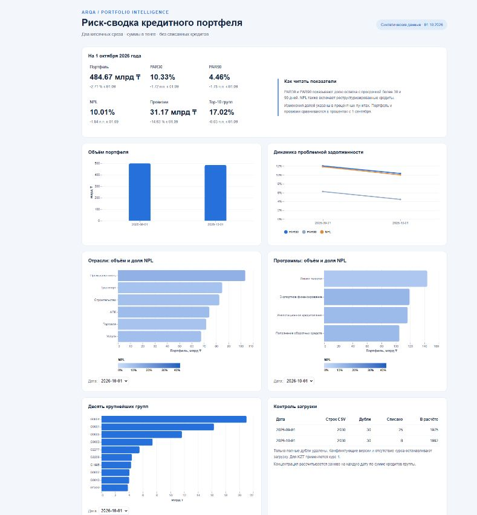

# Риск-сводка кредитного портфеля

Мини-проект для [ARQA](https://jobs.arqa.cc/bi#task). PostgreSQL → витрины reporting → YAML-модель → статичный дашборд Vega-Lite. Данные синтетические, на 01.09.2026 и 01.10.2026.



## Запуск

Нужны Python 3.10+ и Docker Compose. Python использует только стандартную библиотеку, установка пакетов не требуется.

В каталоге проекта создайте `.env` из `.env.example` и задайте локальный пароль PostgreSQL. Затем:

```sh
docker compose up -d --wait
python run.py --docker
python -m http.server 8765 --bind 127.0.0.1 --directory dashboard
```

Откройте http://127.0.0.1:8765. Экспортированные данные и спеки уже включены, поэтому для просмотра достаточно третьей команды. HTML нужно открывать через HTTP, а не двойным щелчком. Библиотеки Vega загружаются с jsDelivr, нужен интернет. После изменения CSV повторите `python run.py --docker` и обновите страницу.

Если PostgreSQL уже установлен, задайте стандартные переменные `PGHOST`, `PGPORT`, `PGDATABASE`, `PGUSER` и при необходимости `PGPASSWORD`. Используйте отдельную базу для этого проекта, поскольку загрузка заменяет содержимое таблиц `raw.portfolio` и `raw.fx`.

```sh
python run.py --psql psql
```

Для Windows аргумент `--psql` может содержать полный путь к `psql.exe`. Локальный прогон выполнен на PostgreSQL 18.6. Compose закрепляет PostgreSQL 16, отдельный прогон на 16 не выполнен из-за недоступности Docker Desktop. SQL использует возможности, доступные в PostgreSQL 16.

## Итоговые показатели

Изменение сравнивает октябрь с сентябрём. Для долей это процентные пункты, для денежных показателей указаны сумма и относительное изменение.

| Показатель | 01.09.2026 | 01.10.2026 | Изменение |
| --- | ---: | ---: | ---: |
| Портфель, ₸ | 498 153 228 694,57 | 484 674 770 832,76 | −13 478 457 861,82, или −2,71% |
| PAR30 | 12,05% | 10,33% | −1,72 п.п. |
| PAR90 | 6,24% | 4,46% | −1,78 п.п. |
| NPL | 11,85% | 10,01% | −1,84 п.п. |
| Провизии, ₸ | 36 512 259 066,30 | 31 171 241 408,38 | −5 341 017 657,92, или −14,63% |
| Провизии / портфель | 7,33% | 6,43% | −0,90 п.п. |
| Концентрация Top-10 групп | 17,04% | 17,02% | −0,03 п.п. |
| Кредитов в расчёте | 1 975 | 1 992 | +17 |

Изменения рассчитаны до округления, поэтому разность округлённых значений может отличаться на 0,01 п.п. Полные значения: [metrics.json](dashboard/data/metrics.json).

## Три вывода для риск-комитета

1. **Проблемная задолженность уменьшилась быстрее портфеля.** Портфель сократился на 2,71%, NPL в деньгах снизился с 59,04 до 48,53 млрд ₸, а его доля с 11,85% до 10,01%. Провизии уменьшились на 5,34 млрд ₸. По двум срезам нельзя установить причину улучшения. Перед выводом о качестве взыскания нужна сверка погашений, новых выдач, списаний и валютной переоценки.
2. **Реструктуризация остаётся существенной частью риска.** В октябре NPL составляет 10,01%, тогда как PAR90 только 4,46%. Разница 5,55 п.п., или 26,89 млрд ₸, относится к реструктуризированным кредитам с просрочкой не более 90 дней. Их стоит контролировать отдельно, даже когда тяжёлой просрочки нет.
3. **Концентрация почти не изменилась, отраслевой риск неоднороден.** На десять крупнейших групп приходится 17,02% портфеля против 17,04% месяцем ранее. Промышленность одновременно крупнейшая отрасль по остатку, 103,59 млрд ₸, и имеет наибольшую долю NPL, 13,53%. Стоит отдельно рассмотреть крупнейшие проблемные группы промышленности. Это приоритет для проверки, а не вывод о превышении лимитов: лимиты в задании не заданы.

## Правила расчёта

Единица витрины: **один кредит на одну дату**. Даты не суммируются между собой, поскольку это остатки, а не потоки.

- Портфель: `SUM(principal_outstanding × rate_kzt)` после исключения `written_off = 1`.
- Для KZT курс равен 1. Для USD используется курс строго на дату среза. Подстановка ближайшего курса не применяется.
- PAR30: сумма остатков с `days_past_due > 30`, делённая на портфель.
- PAR90: аналогично с `days_past_due > 90`.
- NPL: сумма остатков с `days_past_due > 90 OR restructured = 1`, делённая на портфель. Пересечение учитывается один раз.
- Провизии: 50% для NPL, иначе 10% при 31–90 днях, иначе 1%. Проверка NPL стоит первой, поэтому реструктуризация имеет приоритет перед диапазоном просрочки.
- Top-10: сначала складываются кредиты внутри `group_id`, затем выбираются десять крупнейших групп отдельно на каждую дату. При равенстве суммы порядок определяется `group_id`.
- В SQL используется `NUMERIC`, суммы не округляются на уровне кредита. Округление применяется при отображении. JSON предназначен для визуализации, SQL и независимый Decimal-расчёт сохраняют точность.

Провизии рассчитаны по упрощённым правилам задания. Это не реализация модели ожидаемых кредитных убытков МСФО 9.

## Очистка и проверки

| Контроль | Сентябрь | Октябрь |
| --- | ---: | ---: |
| Строк в CSV | 2 030 | 2 030 |
| Полных дублей удалено | 30 | 30 |
| Уникальных кредитов до исключений | 2 000 | 2 000 |
| Списанных кредитов исключено | 25 | 8 |
| Осталось в расчёте | 1 975 | 1 992 |

Удаляются только полные дубли. Разные версии одного кредита на одну дату вызывают ошибку. Конфликтующие курсы, отсутствующий курс, пустые измерения, некорректные даты, отрицательные остатки или просрочка и неверные флаги также не проходят проверку. Загрузка и проверка SQL выполняются в транзакции, при ошибке предыдущий набор данных сохраняется.

`run.py` выполняет 44 сравнения: независимо пересчитывает показатели из исходных CSV с Python Decimal и проверяет, что разрезы по отрасли и программе сходятся с итогом. Затем запускает SQL-фикстуру для 30/31/90/91 дней, реструктуризации без просрочки, конвертации USD, дубля, списания, группировки связанных кредитов, ранжирования Top-10 и видимости отсутствующего курса. Фикстура выполняется с ROLLBACK. Повторная полная загрузка должна дать те же результаты. Фактический отчёт и SHA-256 исходников: [validation.json](validation.json).

В браузере проверена загрузка всех шести визуализаций. Скриншот сделан с работающей HTML-страницы.

## Файлы

| Путь | Назначение |
| --- | --- |
| `data/` | Исходные CSV с сайта задания |
| `sql/01_raw.sql` | Схемы и сырые таблицы |
| `sql/02_views.sql` | Очищенная витрина, группы, метрики, изменения, разрезы, контроль загрузки |
| `sql/03_checks.sql` | Контроль качества входных данных и инвариантов |
| `semantic/portfolio.yaml` | Источник, измерения и аддитивные меры |
| `tests/edge_cases.sql` | Проверки граничных случаев |
| `run.py` | Загрузка, независимая сверка, экспорт и повторный прогон |
| `build_dashboard.py` | Генерация JSON-спек из результатов SQL |
| `dashboard/specs/` | Отдельные Vega-Lite JSON-спеки |
| `dashboard/index.html` | Статичная страница с vega-embed |
| `AGENTS.md`, `AI_NOTES.md` | Инструкции агенту и реальные ошибки в процессе |

В YAML меры аддитивны внутри одного среза. Для долей используется отношение сумм числителя и знаменателя, а не среднее долей. Top-10 не аддитивен по сегментам и рассчитывается отдельной SQL-витриной. Дашборд использует экспорт SQL, отдельный исполняющий YAML движок в мини-проект не включён.

Источники: [portfolio.csv](https://jobs.arqa.cc/bi/files/portfolio.csv), [fx.csv](https://jobs.arqa.cc/bi/files/fx.csv), получены 22.10.2026. Справочники: [PostgreSQL 16 CREATE VIEW](https://www.postgresql.org/docs/16/sql-createview.html), [Vega-Lite](https://vega.github.io/vega-lite/docs/concat.html).
